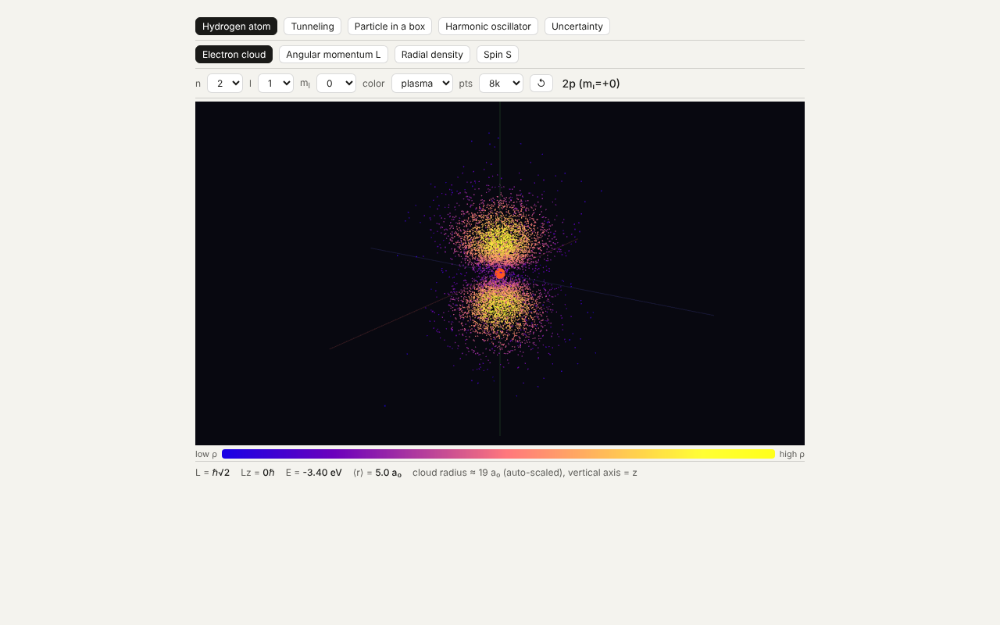
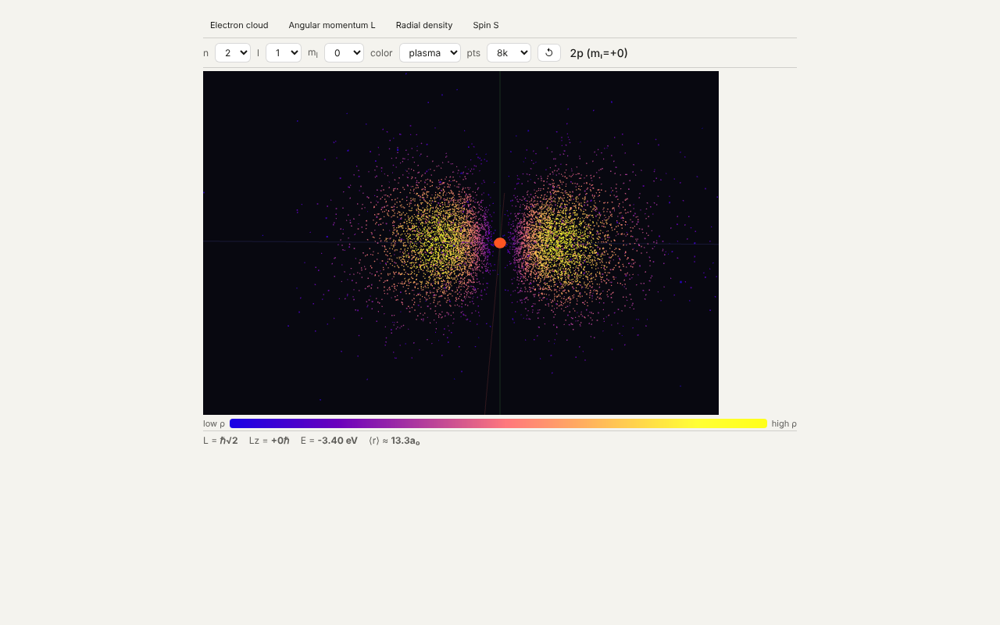

<div align="center">

# ⚛️ Physics Learning Resources

Interactive atomic and quantum physics visualisations that run in the browser. No install, no build step.

[](https://meshannawod.github.io/physics-learning-resources/)

  



</div>

## Simulations

| | Simulation | What it shows |
|---|---|---|
|  | **[Hydrogen atom orbital visualizer](https://meshannawod.github.io/physics-learning-resources/hydrogen_atom_fixed.html)** | Electron clouds for chosen quantum numbers (n, l, m), angular momentum, radial probability density and spin |
|  | **[Quantum lab](https://meshannawod.github.io/physics-learning-resources/quantum_lab.html)** | Hydrogen atom, tunnelling, particle in a box, harmonic oscillator, spin ½ and the uncertainty principle in one tabbed lab |

## Run locally

Download the repository and open either `.html` file in a modern browser (Chrome, Edge or Firefox). Three.js loads from a CDN, so you need an internet connection the first time.

## Files

```text
index.html                 landing page (GitHub Pages home)
hydrogen_atom_fixed.html   hydrogen orbital visualizer
quantum_lab.html           multi-topic quantum lab
docs/                      screenshots
```

See also **[quantum-mechanics-learning-resources](https://github.com/MeshanNawod/quantum-mechanics-learning-resources)** for the wave superposition lab.

## Author

Made by **Meshan Nawod**, Physics undergraduate at the University of Peradeniya · [Portfolio](https://meshannawod.github.io/) · [GitHub](https://github.com/MeshanNawod)
